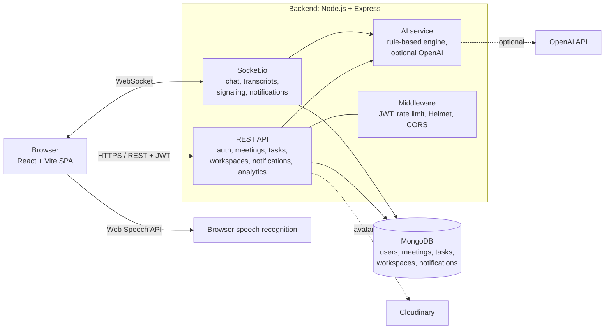
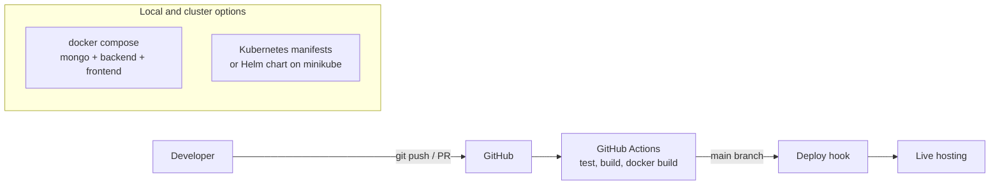

# IntellMeet: AI-Powered Enterprise Meeting & Collaboration Platform

> Real-time meetings, AI summaries, smart action items and team task boards in one MERN application.


| | |
|---|---|
| **Live demo** | https://YOUR-LIVE-URL |
| **Demo video** | https://YOUR-VIDEO-LINK |
| **Repository** | https://github.com/yash-deshpande24/IntellMeet-AI-Powered-Enterprise-Meeting-Collaboration-Platform |
| **Demo login** | `YOUR_DEMO_EMAIL` / `YOUR_DEMO_PASSWORD` (seeded account) |

Built for Zidio Development (Web Development / MERN domain) as a 28-day project.

---

## 1. Overview

**Problem.** Teams lose hours to meeting follow-up: writing notes, chasing action items, and
tracking who owns what.

**Solution.** IntellMeet turns a meeting into trackable work. It captures the transcript,
generates a summary with decisions and action items, converts action items into tasks on a
Kanban board, and notifies the people involved.

**Target users.** Remote and hybrid teams, project leads, and engineering managers.

### Non-functional goals

| Goal | Target in the plan | How it is addressed |
|---|---|---|
| Real-time latency | under 200 ms | Socket.io events for chat, transcripts and notifications |
| Scalability | horizontal scaling | Stateless API, Docker images, Kubernetes manifests, HPA |
| Security | JWT, role-based access | bcrypt hashing, JWT auth middleware, rate limiting, Helmet |
| Observability | logging, monitoring | Request logging and `/api/health` endpoint |

> Targets such as 99.95% uptime and 5,000 concurrent participants are design goals from the
> project brief. They were not load-tested at that scale.

---

## 2. Key features

| ID | Feature | Description | Status |
|---|---|---|---|
| F-01 | Authentication and profiles | Signup, login, JWT, bcrypt, roles (Admin, Member), avatar upload (Cloudinary with Base64 fallback) | Done |
| F-02 | Meetings | Create, schedule, join by room code, lobby, live room, history | Done |
| F-03 | AI meeting intelligence | Summary, key points, decisions, action items with assignee and priority, sentiment, speaker talk-time | Done (rule-based engine, optional OpenAI) |
| F-04 | Real-time collaboration | Socket.io chat, transcript events, presence | CONFIRM STATUS |
| F-05 | Post-meeting dashboard | Summaries, transcripts, action items | Done |
| F-06 | Workspaces and Kanban | Workspaces, 5-column board, drag and drop, task creation, tasks from action items | Done |
| F-07 | Notifications | Live notifications, bell with unread state, read persistence | Done |
| F-08 | Analytics | Meeting and productivity metrics endpoint and dashboard | CONFIRM STATUS |
| F-09 | DevOps | Docker, Compose, Kubernetes manifests, Helm chart, GitHub Actions | Done |

Edit the status column so it matches what your demo really does. Judges compare it with the code.

---

## 3. Architecture



A text version for the PDF is in [`docs/architecture.md`](docs/architecture.md), and an image is in
[`docs/architecture.svg`](docs/architecture.svg).

### Deployment architecture



---

## 4. Technology stack

| Layer | Technology | Why |
|---|---|---|
| Frontend | React, Vite, Tailwind CSS, React Router, Axios | Fast dev server, component pages, utility styling |
| Backend | Node.js, Express | Lightweight REST API |
| Database | MongoDB with Mongoose | Flexible schemas for meetings and tasks |
| Real-time | Socket.io | Chat, transcripts, notifications, signaling |
| Speech | Web Speech API (browser) | Live captions without paid keys |
| AI | Built-in rule-based engine, optional OpenAI | Works with no paid keys; OpenAI used only if a key is set |
| Auth | JWT, bcrypt | Stateless auth, hashed passwords |
| Media | Cloudinary (Base64 fallback) | Avatar upload |
| Containers | Docker multi-stage, Docker Compose | Small images, one-command local stack |
| Orchestration | Kubernetes manifests, Helm chart | Scalable deployment, HPA |
| CI/CD | GitHub Actions | Tests, build, image builds on every push |

---

## 5. Project structure

```
IntellMeet-AI-Powered-Enterprise-Meeting-Collaboration-Platform/
├── Backend/            Express API, Socket.io, models, services, tests
├── Frontend/           React + Vite + Tailwind app
├── k8s/                Kubernetes manifests
├── helm/intellmeet/    Helm chart
├── docs/               Architecture diagram and screenshots
├── .github/workflows/  CI/CD pipeline
└── docker-compose.yml  Runs MongoDB + backend + frontend
```

---

## 6. Getting started

### Option A: Docker Compose (recommended)

```bash
git clone https://github.com/yash-deshpande24/IntellMeet-AI-Powered-Enterprise-Meeting-Collaboration-Platform.git
cd IntellMeet-AI-Powered-Enterprise-Meeting-Collaboration-Platform
docker compose up --build
```
Open http://localhost:8080. The backend seeds demo accounts on first start.

### Option B: run locally

```bash
# Backend
cd Backend
npm install
npm run dev          # http://localhost:5000

# Frontend (new terminal)
cd Frontend
npm install
npm run dev          # http://localhost:5173
```
Create `Backend/.env` with `MONGO_URI`, `JWT_SECRET`, `PORT` and `CLIENT_URL`. Cloudinary and
OpenAI keys are optional.

### Option C: Kubernetes (minikube)

See [`k8s/README.md`](k8s/README.md). Helm: `helm install intellmeet ./helm/intellmeet -n intellmeet-helm --create-namespace`.

---

## 7. Execution timeline

| Week | Focus | Deliverables |
|---|---|---|
| 1 | Backend and auth | Express setup, MongoDB, JWT, bcrypt, rate limiting, meeting CRUD, Socket.io |
| 2 | Frontend and real-time | React app, auth pages, lobby, live room, chat, participants |
| 3 | AI and collaboration | Transcript, summary and action items, post-meeting dashboard, Kanban, tasks from action items, notifications, accuracy test |
| 4 | Deployment and polish | Docker, Kubernetes and Helm, GitHub Actions, live deployment, monitoring, load and security testing, README and demo video |

---

## 8. Technical highlights

### Security
- Passwords hashed with bcrypt; JWT-protected routes and role checks
- Rate limiting on authentication routes; Helmet security headers; CORS allow-list
- Secrets kept in environment variables and out of the repository; `.env` excluded from Docker images
- Backend container runs as a non-root user

### AI accuracy test
`node Backend/tests/summaryAccuracy.js` scores the built-in summarizer on sample meetings with known
action items and decisions (recall, precision and F1).

| Run | Average score |
|---|---|
| Before improving the extraction rules (decisions were hard-coded) | 47% |
| After extracting decisions and actions from the transcript | 100% on 3 samples |

The rules were tuned on those 3 samples, so 100% shows the fix worked and is not a general accuracy
claim. It is a small keyword-based sample test, not a formal benchmark. Add UNSEEN-SAMPLE RESULT here
after you run the unseen meetings.

### Performance and scalability
- Multi-stage Docker builds keep runtime images small
- Stateless API behind a Service; Horizontal Pod Autoscaler (2 to 6 pods at 70% CPU) in the manifests
- Add your load-test (JMeter) results and Lighthouse scores here once measured

### Challenges and solutions
| Challenge | Solution |
|---|---|
| Decisions in the built-in summary were hard-coded | Rewrote extraction to read the transcript; decision lines are never also counted as actions |
| Port 5000 conflict when starting Docker | Found the process with `netstat`, stopped it, restarted Compose |
| Docker Desktop Kubernetes would not start | Used minikube; validated manifests offline with kubeconform |
| Linux build failing on file-name case | Renamed `Kanbanboardpage.js` to `KanbanBoardPage.jsx` to match imports |

---

## 9. CI/CD and deployment

- **CI/CD:** GitHub Actions workflow `CI/CD` runs backend tests, a frontend build and Docker image builds on every push and pull request, then triggers a deploy hook from `main`.
- **Containers:** `Backend/Dockerfile` and `Frontend/Dockerfile` (multi-stage; the frontend is served by nginx).
- **Kubernetes:** 9 resources in `k8s/`, validated offline with kubeconform (9 valid, 0 invalid). Deployed and tested on minikube using local images.
- **Helm:** chart in `helm/intellmeet` with image tags, replicas, resources and secrets in `values.yaml`.
- **Hosting:** FILL IN (for example Vercel + Render + MongoDB Atlas).

---

## 10. Screenshots

| | |
|---|---|
|  |  |
|  |  |

Add the remaining screenshots (login, meeting room, AI summary, action items) under `docs/screenshots/`.

---

## 11. Known limitations

Replace this list with the truth for your build. Examples to check:
- Real WebRTC video between participants: CONFIRM (the plan lists it)
- Recording: CONFIRM
- Refresh tokens and Redis caching: CONFIRM (listed in the plan)
- Socket.io with more than one backend replica needs sticky sessions or a Redis adapter
- MongoDB in the manifests is a single instance without authentication
- The built-in summarizer is rule-based; use OpenAI by setting `OPENAI_API_KEY` for better quality

---

## 12. Personal reflection

Write this in your own words: what you learned (real-time systems, Docker, CI/CD, testing an AI
feature honestly), which practices you applied, and what you would build next (real WebRTC video,
Redis adapter for Socket.io, refresh tokens, monitoring with Prometheus and Grafana).

---

## Author

**Yash Deshpande**: [GitHub](https://github.com/yash-deshpande24)