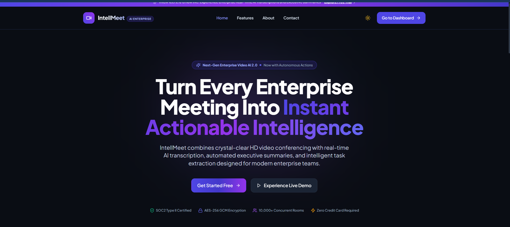
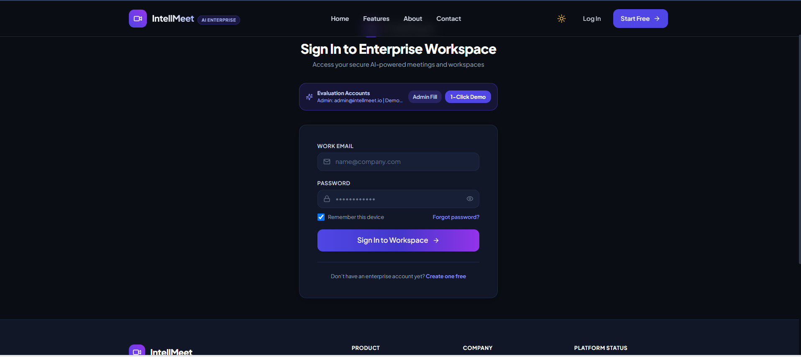
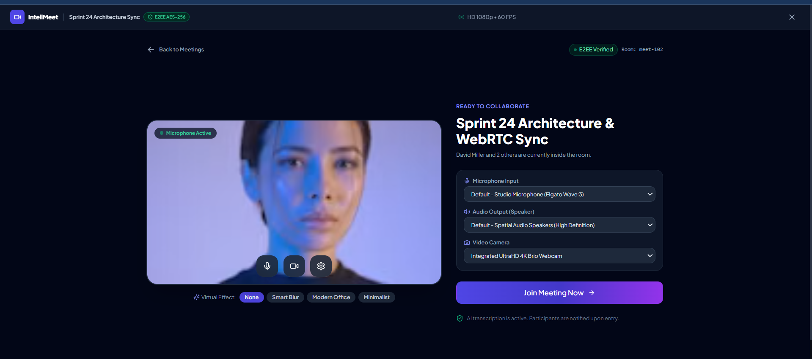
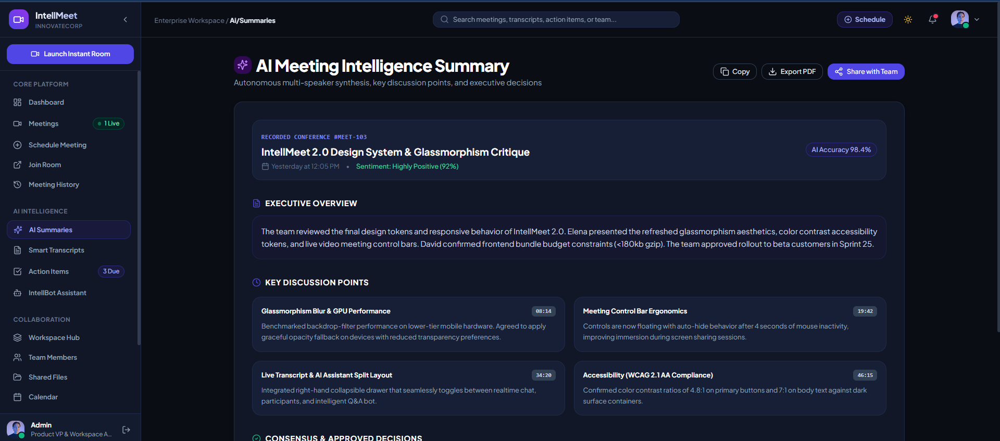
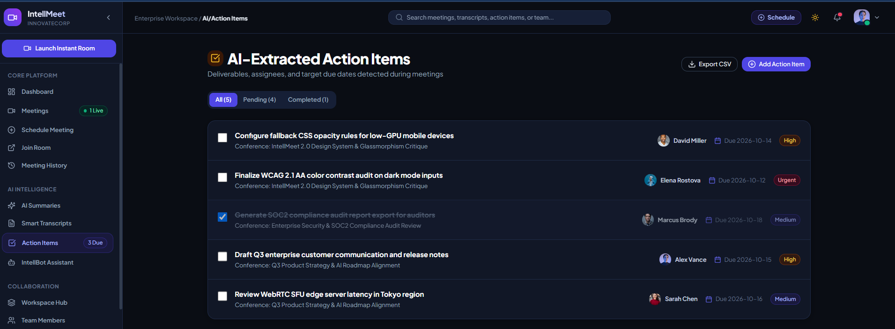
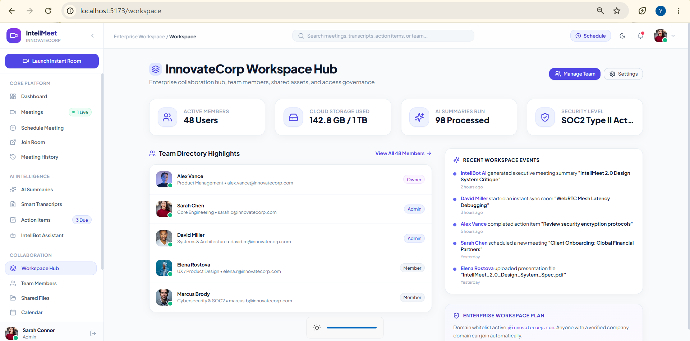
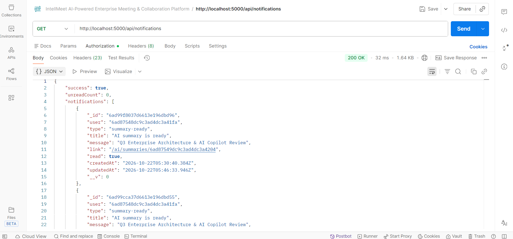
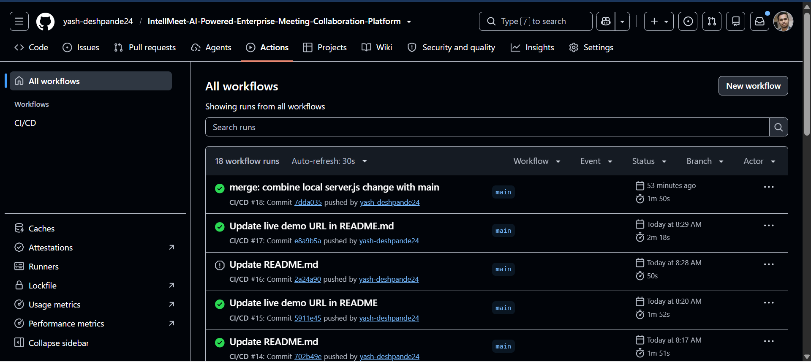
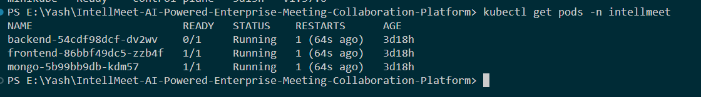
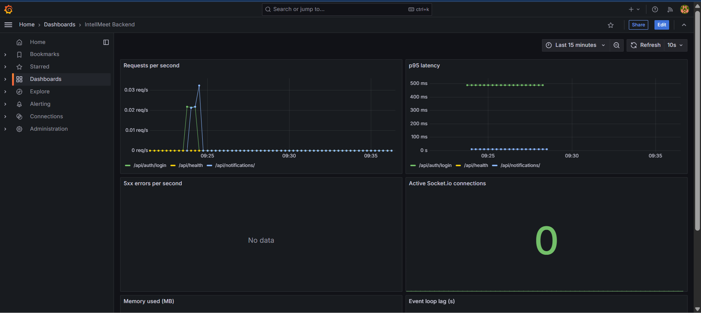

# IntellMeet: AI-Powered Enterprise Meeting & Collaboration Platform

> Real-time meetings, live captions, AI summaries, smart action items and team task boards in one MERN application.

[](https://github.com/yash-deshpande24/IntellMeet-AI-Powered-Enterprise-Meeting-Collaboration-Platform/actions)

| | |
|---|---|
| **Live demo** | https://intell-meet-ai-powered-enterprise-m-ebon.vercel.app/ |
| **API health check** | https://intellmeet-ai-ei2d.onrender.com/api/health |
| **Demo login (admin)** | `admin@intellmeet.io` / `password123` |
| **Demo login (member)** | `member@intellmeet.io` / `password123` |
| **Demo video** | <VIDEO_URL> |
| **Documentation (PDF)** | Submitted with the project |

> **Before you open the demo:** the API runs on a free Render instance that sleeps when idle, so the first request can take 30 to 60 seconds. Open the API health link once, then use the app.
> Live captions use the browser's built-in speech recognition and work in **Chrome and Edge**.

## Contents

1. [What it does](#1-what-it-does)
2. [Try it in 2 minutes](#2-try-it-in-2-minutes)
3. [Features](#3-features)
4. [Screenshots](#4-screenshots)
5. [Tech stack](#5-tech-stack)
6. [Architecture](#6-architecture)
7. [Project structure](#7-project-structure)
8. [Run it locally](#8-run-it-locally)
9. [Environment variables](#9-environment-variables)
10. [API reference](#10-api-reference)
11. [Real-time events](#11-real-time-events)
12. [Docker, Kubernetes and Helm](#12-docker-kubernetes-and-helm)
13. [CI/CD](#13-cicd)
14. [Monitoring](#14-monitoring)
15. [Testing](#15-testing)
16. [Security](#16-security)
17. [Troubleshooting](#17-troubleshooting)
18. [Known limitations and roadmap](#18-known-limitations-and-roadmap)
19. [Author](#19-author)

---

## 1. What it does

Meetings waste time because decisions and tasks get lost afterwards. IntellMeet turns every meeting into something trackable:

1. **Meet.** Join a room, chat, and turn on live captions.
2. **Summarize.** When the meeting ends, the AI engine builds an executive summary, key points, decisions, action items and a sentiment score from the real transcript.
3. **Act.** Convert an action item into a task on the Kanban board and assign it to a teammate.
4. **Notify.** The assignee gets a live notification in the app.
5. **Measure.** A dashboard shows meeting and task analytics.

## 2. Try it in 2 minutes

1. Open the API health link above once, so the free server wakes up.
2. Open the live demo and log in as **admin@intellmeet.io** (`password123`).
3. Open **Meetings**, join the room `int-arch-sync-2026`, and click the captions button (Chrome or Edge). Say a sentence such as: *"We decided to deploy the preview build on Friday. Alex will finish the Kanban integration tomorrow, it is urgent."*
4. Click **Leave**, then **End & View AI Summary**. The decision and the action item appear.
5. Open **Action Items** and convert the item to a task, assigned to **Alex Rivera**.
6. In a second browser window (or a private window), log in as **member@intellmeet.io**. The notification bell shows the new task live.
7. Open the **Workspace** to see the task on the Kanban board.

## 3. Features

| ID | Feature | Status |
|---|---|---|
| F-01 | Authentication: signup, login, JWT, bcrypt, roles (Admin, Member), profile and avatar upload | Done |
| F-02 | Real-time meeting room: Socket.io rooms, WebRTC signaling, chat, screen-share and hand-raise events | Partial. Signaling and events are built; the room UI still shows demo participant tiles |
| F-03 | AI meeting intelligence: live captions (Web Speech API), transcript storage, summary, decisions, action items, sentiment, speaker analytics | Done (built-in rule-based engine, optional OpenAI) |
| F-04 | Real-time collaboration: chat, @mentions, live notifications | Done |
| F-05 | Post-meeting dashboard: summary, transcript, action items | Done |
| F-06 | Team and project management: workspaces, Kanban board, task assignment | Done |
| F-07 | Analytics: meeting and task metrics | Done |

## 4. Screenshots

Save your screenshots in `docs/screenshots/` with these names, and they will show here.

| | |
|---|---|
|  |  |
|  |  |
|  |  |
|  |  |
|  |  |

## 5. Tech stack

| Layer | Technology |
|---|---|
| Frontend | React, Vite, Tailwind CSS, React Router, Context API |
| Backend | Node.js, Express |
| Database | MongoDB with Mongoose (MongoDB Atlas in the cloud) |
| Real-time | Socket.io, WebRTC signaling |
| AI | Built-in rule-based NLP engine (no paid key needed), optional OpenAI |
| Auth and security | JWT, bcrypt, Helmet, CORS allow-list, express-rate-limit |
| File storage | Cloudinary, with a free Base64 fallback |
| Containers | Docker multi-stage builds, Docker Compose |
| Orchestration | Kubernetes manifests packaged as a Helm chart |
| CI/CD | GitHub Actions: tests, Helm lint, Docker build and publish |
| Hosting | Vercel (frontend), Render (backend), MongoDB Atlas (database) |
| Monitoring | Prometheus metrics, Grafana dashboard, Sentry (optional), uptime monitor |

## 6. Architecture

```
                  +--------------------+
   Browser  ----> |  React (Vercel)    |
   (HTTPS)        +---------+----------+
                            | REST + WebSocket
                            v
                  +--------------------+         +----------------+
                  | Express + Socket.io| ------> | MongoDB Atlas  |
                  | (Render / Docker)  |         +----------------+
                  +----+----------+----+
                       |          |
            /metrics   |          |  transcripts, notifications
                       v          v
               +-------------+   AI engine (rule-based, optional OpenAI)
               | Prometheus  |
               |  + Grafana  |
               +-------------+
```

Request flow for the core feature: the browser sends transcript lines over Socket.io, the server stores them on the meeting, and when the meeting ends the AI service reads the transcript and writes the summary. Converting an action item creates a task and a notification, which is pushed to the assignee's private socket room.

## 7. Project structure

```
IntellMeet-AI-Powered-Enterprise-Meeting-Collaboration-Platform/
├── Backend/
│   ├── Dockerfile, .dockerignore, package.json, server.js
│   ├── tests/summaryAccuracy.js
│   └── src/
│       ├── server.js
│       ├── config/          db.js, cloudinary.js
│       ├── controllers/     analytics, auth, meeting, notification, task, workspace
│       ├── middleware/      auth.js, rateLimiter.js, upload.js
│       ├── models/          Meeting, Notification, Task, User, Workspace
│       ├── monitoring/      metrics.js, sentry.js
│       ├── routes/
│       ├── services/        aiService.js, notificationService.js
│       └── sockets/         meetingSocket.js
├── Frontend/
│   ├── Dockerfile, nginx.conf, vercel.json, package.json
│   └── src/
│       ├── components/common/
│       ├── context/         Auth, Meeting, Notification, Theme
│       ├── hooks/           useSpeechTranscription.js
│       ├── layouts/
│       ├── pages/           ai, auth, collaboration, dashboard, meetings, public, settings
│       └── services/        api.js, socket.js, meetingService.js, taskService.js, ...
├── K8s/helm/intellmeet/     Helm chart (Chart.yaml, values.yaml, templates/)
├── monitoring/              Prometheus and Grafana configuration
├── loadtest/                load-test.mjs, security-check.mjs
├── .github/workflows/ci.yml CI/CD pipeline
├── docker-compose.yml       MongoDB + backend + frontend
└── README.md
```

## 8. Run it locally

### Option A: Docker (easiest)

Requires Docker Desktop.

```bash
docker compose up --build
```

Open http://localhost:8080 and log in with the demo account.

### Option B: run each part

Requires Node.js 20 and a MongoDB (local, or an Atlas connection string).

```bash
# Backend
cd Backend
npm install
# put your MONGODB_URI in Backend/.env.local (this file is git-ignored)
node server.js              # http://localhost:5000

# Frontend (new terminal)
cd Frontend
npm install
npm run dev                 # http://localhost:5173
```

On the first start, the backend creates the demo accounts and sample data (`NODE_ENV=development`).

## 9. Environment variables

**Backend**

| Variable | Purpose |
|---|---|
| `MONGODB_URI` | Database connection string |
| `JWT_SECRET` | Secret used to sign tokens (required) |
| `ALLOWED_ORIGINS` | Comma-separated frontend URLs allowed by CORS |
| `NODE_ENV` | `development` or `production` |
| `HTTPS_ORIGIN` | Public API URL (required in production) |
| `SEED_DEMO_DATA` | `true` creates the demo accounts when running in production |
| `PORT` | Server port (default 5000) |
| `OPENAI_API_KEY`, `AI_MODEL` | Optional. Leave empty to use the free built-in AI engine |
| `CLOUDINARY_*` | Optional. Leave empty to use the Base64 fallback |
| `SENTRY_DSN`, `METRICS_TOKEN` | Optional monitoring settings |
| `RATE_LIMIT_MAX`, `AUTH_RATE_LIMIT_MAX` | Raise the limits for local load tests only |

Private values go in `Backend/.env.local` (not committed). `Backend/.env` contains safe defaults only.

**Frontend**

| Variable | Purpose |
|---|---|
| `VITE_API_URL` | API address, for example `https://intellmeet-ai-ei2d.onrender.com/api` |
| `VITE_SENTRY_DSN` | Optional error tracking |

## 10. API reference

All routes except health, metrics, register and login need the header `Authorization: Bearer <token>`.

| Area | Method and path | Purpose |
|---|---|---|
| Auth | `POST /api/auth/register` | Create an account |
| | `POST /api/auth/login` | Log in, returns a token |
| | `GET /api/auth/me` | Current user |
| | `PUT /api/auth/profile` | Update profile |
| | `POST /api/auth/avatar` | Upload an avatar |
| | `GET /api/auth/users` | List users |
| Meetings | `GET, POST /api/meetings` | List or create meetings |
| | `GET /api/meetings/code/:code` | Find a meeting by room code |
| | `GET /api/meetings/:id` | Meeting details, transcript and summary |
| | `PATCH /api/meetings/:id/status` | Set `scheduled`, `active` or `completed` |
| | `POST /api/meetings/:id/ai-summary` | Generate the AI summary |
| | `POST /api/meetings/:id/transcript` | Add a transcript line |
| | `POST /api/meetings/:meetingId/action-items/:actionItemId/convert` | Turn an action item into a task |
| Tasks | `GET, POST /api/tasks` | List or create tasks |
| | `PUT, DELETE /api/tasks/:id` | Update or delete a task |
| | `PATCH /api/tasks/:id/status` | Move a task between columns |
| Workspaces | `GET, POST /api/workspaces` | List or create workspaces |
| Analytics | `GET /api/analytics` | Dashboard metrics |
| Notifications | `GET /api/notifications` | Your notifications and unread count |
| | `PATCH /api/notifications/:id/read` | Mark one as read |
| | `PATCH /api/notifications/read-all` | Mark all as read |
| System | `GET /api/health` | Health check |
| | `GET /metrics` | Prometheus metrics (token optional) |

## 11. Real-time events

Socket.io events handled by `Backend/src/sockets/meetingSocket.js`:

| Event | Direction | Purpose |
|---|---|---|
| `register-user` | client to server | Joins your private room for notifications (verifies the JWT) |
| `notification:new` | server to client | A new notification for you |
| `join-room`, `room-peers`, `user-joined`, `user-left` | both | Room presence |
| `offer`, `answer`, `ice-candidate` | both | WebRTC signaling |
| `chat-message`, `typing`, `stop-typing` | both | Chat (supports @mentions) |
| `media-toggle`, `screen-share-toggle`, `hand-raise-toggle`, `send-reaction` | both | Room controls |
| `send-transcript-chunk`, `receive-transcript-chunk` | both | Live captions, saved to the meeting |
| `ask-ai-copilot`, `ai-copilot-response` | both | In-meeting AI assistant |

## 12. Docker, Kubernetes and Helm

Docker images use multi-stage builds. The backend runs as a non-root user and has a health check. The frontend is built with Vite and served by nginx.

```bash
docker build -t intellmeet-backend:local ./Backend
docker build -t intellmeet-frontend:local --build-arg VITE_API_URL=http://localhost:5000/api ./Frontend

# minikube only: make the images available to the cluster
minikube image load intellmeet-backend:local
minikube image load intellmeet-frontend:local

helm lint ./K8s/helm/intellmeet
helm install intellmeet ./K8s/helm/intellmeet -n intellmeet --create-namespace

kubectl port-forward -n intellmeet svc/backend 5000:5000
kubectl port-forward -n intellmeet svc/frontend 8080:80
```

Then open http://localhost:8080. Image tags, replica counts, allowed origins, the JWT secret and autoscaling are set in `K8s/helm/intellmeet/values.yaml`. The chart deploys MongoDB with a persistent volume, the backend, the frontend and optional autoscalers.

## 13. CI/CD

`.github/workflows/ci.yml` runs on every push and pull request to `main` and `dev`:

| Job | What it does |
|---|---|
| Backend tests | Installs dependencies, syntax-checks every source file, runs the AI summary test, starts the API against a real MongoDB and checks `/api/health` |
| Frontend build | Installs, lints and builds the production bundle |
| Helm chart check | `helm lint` and `helm template` |
| Docker images | Builds both images; on `main` it publishes them to GitHub Container Registry |

Render deploys the backend after the checks pass, and Vercel builds the frontend from the same repository.

## 14. Monitoring

- The backend exposes Prometheus metrics at `/metrics` (request counts and latency per route, active socket connections, memory, CPU, event loop lag).
- `monitoring/` contains a Prometheus config and a provisioned Grafana dashboard:

```bash
cd monitoring
docker compose -f docker-compose.monitoring.yml up
```

Prometheus runs at http://localhost:9090 and Grafana at http://localhost:3000 (login `admin` / `admin`, dashboard **IntellMeet Backend**).
- Errors are reported to Sentry when `SENTRY_DSN` is set.
- An uptime monitor can watch `/api/health`.

## 15. Testing

| Test | Command |
|---|---|
| AI summary accuracy on sample meetings | `node Backend/tests/summaryAccuracy.js` |
| Load test (virtual users, latency percentiles, throughput) | `node loadtest/load-test.mjs --users 50 --loops 20` |
| Automated security checks mapped to the OWASP Top 10 | `node loadtest/security-check.mjs` |
| Dependency audit | `npm audit` in `Backend` and `Frontend` |
| Pipeline | GitHub Actions on every push |

For local load tests, start the backend with the rate limits raised (`RATE_LIMIT_MAX` and `AUTH_RATE_LIMIT_MAX`), otherwise the limiter returns `429` responses. The measured results are in the project report (PDF).

## 16. Security

- Passwords are hashed with bcrypt; JWTs expire after 7 days; demo tokens are disabled in production.
- Helmet security headers, a CORS allow-list and a request size limit.
- Rate limiting on every API route, with a stricter limit on login and signup.
- HTTPS is enforced in production; Docker containers run as a non-root user.
- Secrets stay out of git: private values live in `.env.local` or in the Render and Vercel settings.
- The metrics endpoint can be protected with `METRICS_TOKEN`.

## 17. Troubleshooting

| Problem | Fix |
|---|---|
| The first request is very slow | The free server was asleep. Wait up to a minute |
| Login shows a network or CORS error | `ALLOWED_ORIGINS` on the server must match the exact frontend URL, and `VITE_API_URL` must point to the live API |
| Captions button is missing | Use Chrome or Edge |
| `EADDRINUSE ... 5000` | Another process uses port 5000: an old `node` process, a `kubectl port-forward` or Docker |
| `429 Too many requests` during a load test | Start the backend with `RATE_LIMIT_MAX` and `AUTH_RATE_LIMIT_MAX` set high (local only) |
| Backend shows "Fallback Data Mode" | MongoDB is unreachable. Check `MONGODB_URI` and Atlas Network Access |

## 18. Known limitations and roadmap

- The meeting room shows demo participant tiles. Real camera streams over WebRTC (using the existing signaling) are the main next step.
- Meeting rooms are tracked in memory, so the backend runs as a single instance. Horizontal scaling needs the Socket.io Redis adapter.
- Not built yet: refresh tokens, Redis caching and cloud recording.
- Access control needs hardening: ownership checks on tasks and meetings, field allow-lists on updates and authenticated socket room joins.
- The free hosting plan sleeps when idle.

## 19. Author

Built by **Yash Deshpande**, **Tanuj Darokar**, **Sabarish Nathan C** and **Shayali Verma** for the Zidio Development / LogicVeda Web Development (MERN) program, 2026.